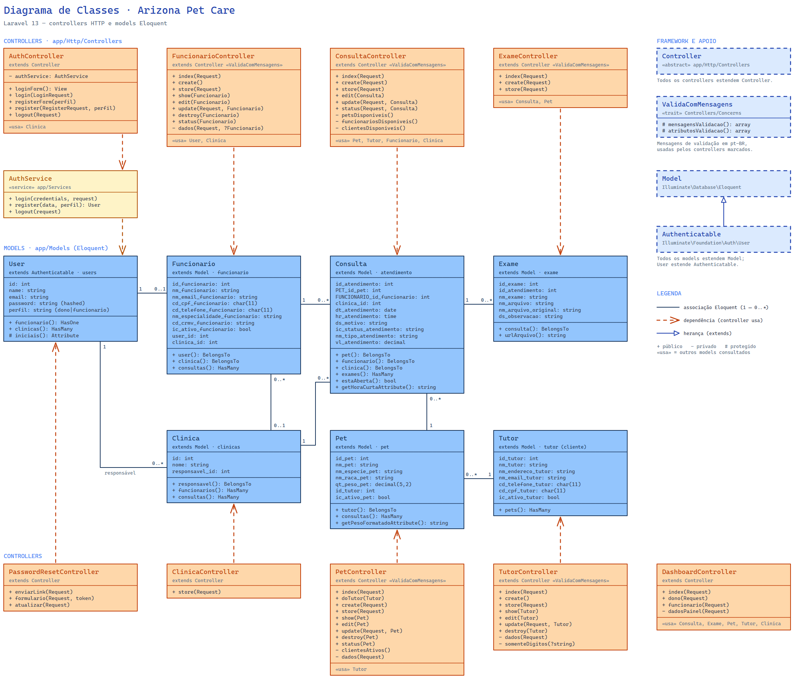

# 5. Diagrama de Classes

Diagrama focado na estrutura de **controllers** (`app/Http/Controllers`) e **models** Eloquent (`app/Models`) da aplicação Laravel.

O arquivo editável é `diagrama_classes.excalidraw`. Para alterá-lo, abra-o em <https://excalidraw.com> (*Open*) e exporte o PNG novamente.

## Como ler

- **Controllers** (laranja) recebem as requisições HTTP das rotas em `routes/web.php`. Todos estendem `App\Http\Controllers\Controller`.
- A **seta tracejada** liga o controller ao model principal que ele manipula. Os outros models consultados aparecem no compartimento `«usa»` de cada controller.
- **Models** (azul) mapeiam as tabelas do banco. O nome da tabela aparece ao lado de `extends`. Todos estendem `Illuminate\Database\Eloquent\Model`; `User` estende `Authenticatable`.
- As **linhas sólidas** entre models são os relacionamentos Eloquent (`belongsTo`/`hasMany`/`hasOne`), com multiplicidade em cada ponta.
- `AuthService` (amarelo) concentra login, cadastro e logout usados pelo `AuthController`.
- A trait `ValidaComMensagens` fornece as mensagens de validação em português aos controllers marcados com `«ValidaComMensagens»`.

## Relacionamentos entre models

| Origem | Relação | Destino | Chave estrangeira | Multiplicidade |
|---|---|---|---|---|
| User | `hasOne` funcionario | Funcionario | `funcionario.user_id` | 1 — 0..1 |
| User | `hasMany` clinicas | Clinica | `clinicas.responsavel_id` | 1 — 0..* |
| Clinica | `hasMany` funcionarios | Funcionario | `funcionario.clinica_id` | 0..1 — 0..* |
| Clinica | `hasMany` consultas | Consulta | `atendimento.clinica_id` | 1 — 0..* |
| Funcionario | `hasMany` consultas | Consulta | `atendimento.FUNCIONARIO_id_funcionario` | 1 — 0..* |
| Tutor | `hasMany` pets | Pet | `pet.id_tutor` | 1 — 0..* |
| Pet | `hasMany` consultas | Consulta | `atendimento.PET_id_pet` | 1 — 0..* |
| Consulta | `hasMany` exames | Exame | `exame.id_atendimento` | 1 — 0..* |

Cada relação `hasMany`/`hasOne` tem a inversa `belongsTo` no model de destino (por exemplo, `Pet::tutor()` e `Consulta::pet()`).

## Controllers e models principais

| Controller | Model principal | Também usa |
|---|---|---|
| AuthController (via AuthService) | User | Clinica |
| PasswordResetController | User (via `Password` broker) | — |
| DashboardController | — (somente leitura) | Consulta, Exame, Pet, Tutor, Clinica |
| ClinicaController | Clinica | User |
| FuncionarioController | Funcionario | User, Clinica |
| TutorController | Tutor | — |
| PetController | Pet | Tutor |
| ConsultaController | Consulta | Pet, Tutor, Funcionario, Clinica |
| ExameController | Exame | Consulta, Pet |
